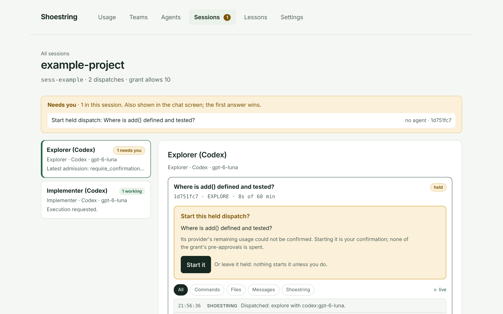
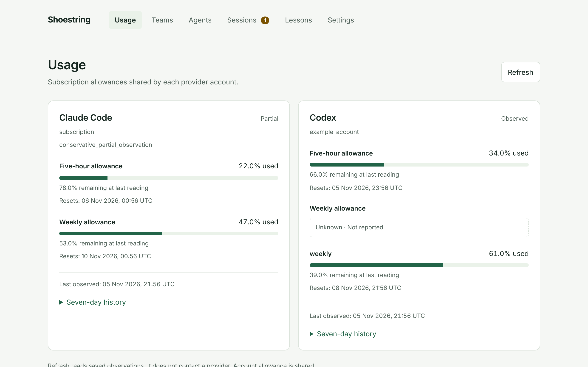
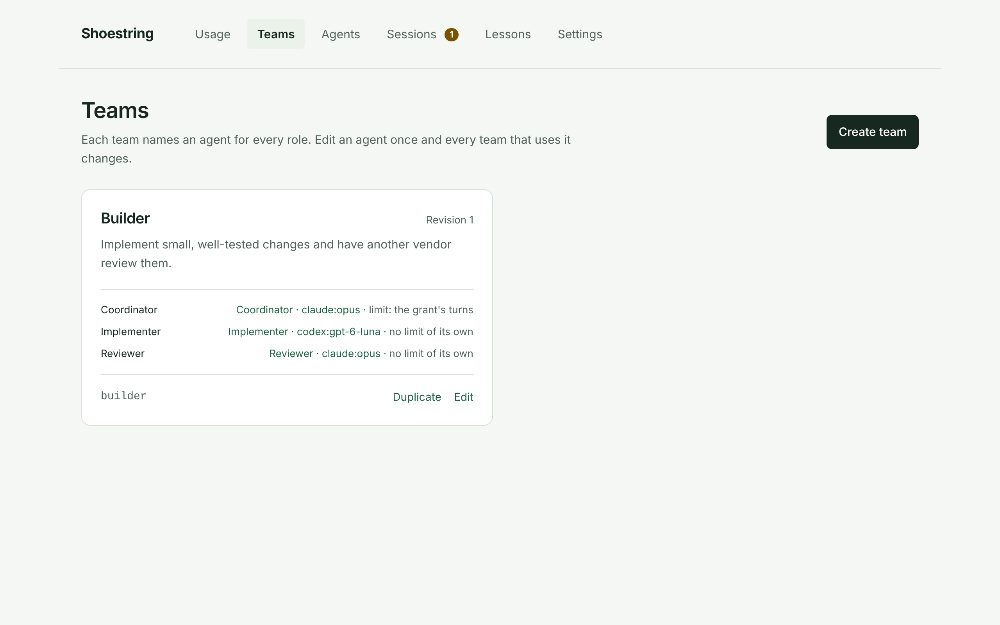
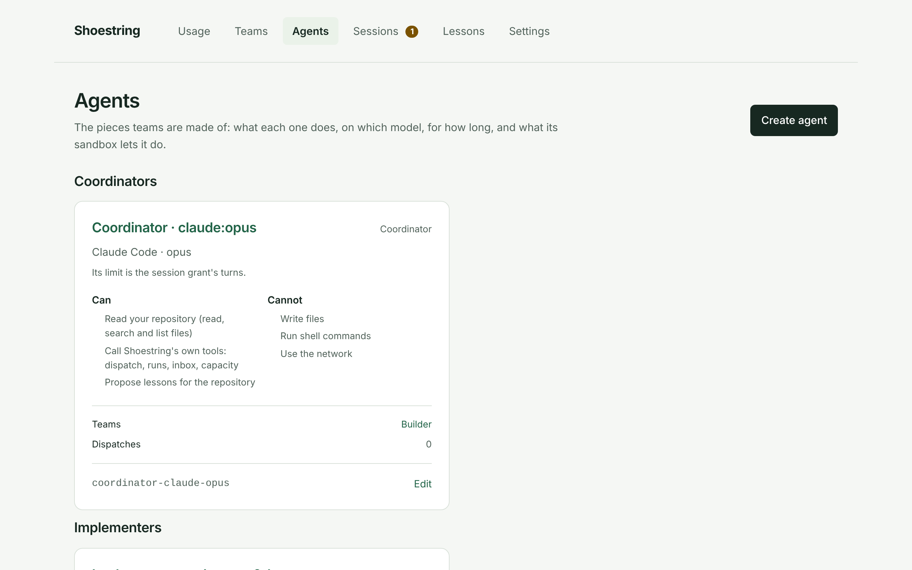
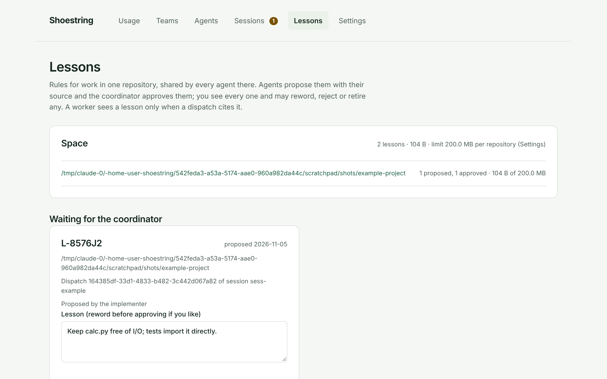

# Shoestring

Shoestring lets you hand coding work to agent CLIs you already use — Claude
Code, Codex and opencode — without handing them your repository or your
usage limits.

You describe the work. Shoestring has an agent plan it, asks you before
anything runs, runs each task as a sandboxed worker in a private copy of your
repository, checks the result with the tests you name, optionally has a model
from another vendor review it, and gives you a verified commit to merge. Your
checkout is never changed, every step is recorded, and nothing is spent
beyond the allowance you grant.

It runs on your own machine. It brings no model and no API key of its own: it
drives the CLIs you have installed and signed in to.



> **Status:** pre-release (0.2.0). Built and tested on **macOS on Apple
> silicon**; no other platform is supported yet. No packaged release has been
> published, so today you install from source. See
> [supported platforms and feature status](docs/support.md) and
> [known limitations](docs/limitations.md).

## Why use it

- **Your checkout stays yours.** Workers write only to their own Git worktree
  outside your repository. You take the result with `git fetch` and
  `git merge`, when you choose.
- **Workers are sandboxed.** A worker cannot read the rest of your home
  folder or reach the network unless you allow it, and when it needs to run
  a command outside its sandbox it asks you first.
- **Checks decide, not the agent.** A task is accepted only when the checks
  you named pass on its commit. Optional cross-review sends the diff to a
  model from another vendor before acceptance.
- **Shared limits are respected.** Shoestring reads each provider's
  remaining subscription usage, keeps a reserve, and asks you when it cannot
  tell. A grant caps how many tasks, how much time and which models a
  coordinator may use.
- **Nothing is lost.** Goals, plans, runs, checks and reviews are recorded in
  a local SQLite database and survive restarts, crashes and provider changes.

## Two ways to work

| | `shoestring do` | `shoestring chat` |
| --- | --- | --- |
| You give it | one request in plain words | a conversation |
| Who plans | Claude drafts a plan; you approve it before anything runs | a coordinator agent (Claude Code, Codex or opencode) that splits work into dispatches |
| What runs | that plan's tasks, one goal at a time | EXPLORE (read-only questions), IMPLEMENT and REVIEW dispatches, within a grant you set |
| Best for | a single, well-defined change | larger work, investigation, several tasks, mixing vendors |

**Start with `shoestring do`.** It has the fewest moving parts and shows the
whole loop — plan, approve, run, check, merge — on one change. Move to
`shoestring chat` when you want an agent to break work down for you.

## Get started

The [getting-started guide](docs/getting-started.md) walks one path from a
fresh Mac to a merged result:

1. Install the prerequisites and build Shoestring from source.
2. Initialize state and run `shoestring setup` to pick your agents.
3. Start the service and leave it running.
4. In a clean Git repository, run your first `shoestring do`.
5. Watch it, then inspect and merge the verified commit.

The short version, once the prerequisites are installed:

```sh
git clone https://github.com/anukin/shoestring.git
cd shoestring
mix setup
mix chat_client.check                   # builds the terminal chat screen
ln -s "$PWD/bin/shoestring" /usr/local/bin/shoestring
shoestring setup                        # check agent CLIs, choose the default agent
mix phx.server                          # leave running; UI at http://localhost:4000
```

Then, in another terminal:

```sh
cd ~/code/my-project                    # a clean Git repository
shoestring do "make add() return the sum of its arguments" --test test/test_calc.py
```

## The web UI

The service serves a local UI at <http://localhost:4000>:

| Page | What it shows |
| --- | --- |
| **Usage** | each provider account's reported allowance, its reset times, and whether the reading is fresh |
| **Teams** | named teams that assign an agent to each role (Coordinator, Explorer, Implementer, Reviewer) |
| **Agents** | each agent's model, time limit, sandbox and extra permissions |
| **Sessions** | coordinator sessions, what each agent is doing, and anything waiting for you |
| **Lessons** | per-repository rules agents have proposed, and your decisions on them |
| **Settings** | shared defaults such as how many tasks may run at once |

| Usage | Teams |
| --- | --- |
|  |  |
| **Agents** | **Lessons** |
|  |  |

Work itself is started, approved and integrated from the CLI; the UI is for
configuration, oversight and answering questions. Screenshots show synthetic
data (see [`tools/screenshots`](tools/screenshots/README.md)).

## How it works

Shoestring is a **supervisor**, not an agent. It owns the durable record —
goals, plans, tasks, runs, checks, reviews — and treats each agent CLI as a
replaceable worker behind an adapter.

```text
you ── shoestring do / chat ──▶ Shoestring service (local, loopback only)
                                   │  plans, grants, admission against usage
                                   │  durable SQLite trajectory
                                   ▼
                     sandboxed workers in private worktrees
                     (Claude Code · Codex · opencode)
                                   │
                                   ▼
                     checks ─▶ optional cross-vendor review ─▶ verified commit
```

The vocabulary you will meet in the CLI and docs — Cobbler, Elf, grant,
dispatch, trajectory — is explained in [concepts](docs/concepts.md).

## Documentation

The [documentation index](docs/README.md) is organised by task: install,
first run, working with `do` or `chat`, configuring agents and teams,
upgrading, troubleshooting, and reference material.

## Contributing and security

- [CONTRIBUTING.md](CONTRIBUTING.md): development setup (Elixir, Erlang,
  Rust, Python, Node), the gate (`mix precommit`), hermetic-test rules and
  how to report bugs.
- [SECURITY.md](SECURITY.md): how to report a vulnerability privately, and
  the trust boundary Shoestring is designed for (one local user, loopback
  only).
- [CHANGELOG.md](CHANGELOG.md): what has changed.

## License

Shoestring is released under the [MIT License](LICENSE). Release packages
carry that license and the notices of every bundled third-party component
(`THIRD_PARTY_NOTICES.md`).
